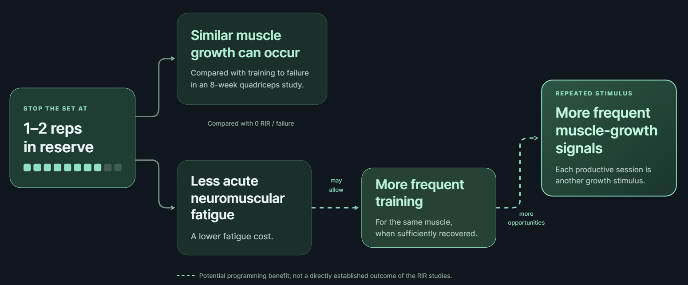

# RepSNS

RepSNS is a hackathon prototype for making resistance-training sets easier to measure. An ESP32-S3 watch times the lifting portion of each rep from a wearable motion sensor, gives a vibration cue when a set reaches its selected slowdown threshold, and saves the readings to microSD. Lift Studio is the companion desktop viewer. It plays back these recordings or shows an estimated 3D pose live over Wi-Fi.

## Try it

- **Watch firmware.** Open [RepWatch.ino](RepWatch/RepWatch.ino) in Arduino IDE for the Waveshare ESP32-S3-Touch-AMOLED-2.06. Follow the [watch setup and calibration guide](RepWatch/README.md).
- **Desktop viewer.** Follow the [Lift Studio setup guide](pullup-viewer/README.md), then launch [Launch-Lift-Studio.cmd](Launch-Lift-Studio.cmd) on Windows. **Demo** uses synthetic data and works without a watch. [Watch the five-exercise demo](pullup-viewer/demo/lift-studio-demo.mp4).
- **Connect the two.** On the watch, turn on **Settings → Wireless**. On the laptop, join **LiftWatch-S3** with password `lift-demo`, select the exercise in Lift Studio, and click **Live**. For offline playback, open a saved CSV from the watch's microSD card.

## What the prototype measures

The watch calibrates the sensor orientation for each exercise. It times the lift between the calibrated start and end regions and uses the first completed lift as the baseline. For example, if the first lift takes 0.50 seconds, a **+80% duration cutoff** triggers at 0.90 seconds into a later lift. The watch records an interrupted attempt separately from completed reps.

The cutoff uses elapsed time as a proxy for slowing. A percentage increase in time is different from a percentage decrease in measured velocity. Pauses and changes in range can also affect the elapsed time. Lift Studio uses the tilt of one segment to animate hammer curls, squats, deadlifts, bench presses, and pull-ups. The remaining joints follow an exercise model. Direct measurement of bar velocity and validation against reps in reserve are future research questions.

## Premise

### Muscle mass, body composition, and cancer

Low muscle mass and high adiposity have been associated with poorer outcomes in some groups of cancer patients. In a study of people with nonmetastatic breast cancer, researchers observed the highest mortality in the group with both low muscle mass and high adiposity. The study measured associations between body composition and survival. [Caan et al., JAMA Oncology](https://jamanetwork.com/journals/jamaoncology/fullarticle/2677300)

Cancer cachexia involves ongoing skeletal muscle loss and can impair physical function. ASCO guidance discusses aerobic and resistance exercise during active treatment with curative intent to help mitigate treatment side effects. That clinical context motivated the project. RepSNS is an exercise-tracking prototype whose effects on patient outcomes have not been studied. [International consensus on cancer cachexia](https://pubmed.ncbi.nlm.nih.gov/21296615/) · [ASCO guideline on exercise during cancer treatment](https://pubmed.ncbi.nlm.nih.gov/35576506/)

### Why measure the set?

Without technology assistance, a lifter estimating reps in reserve (RIR) must judge how many more reps they could complete before reaching failure. That estimate can be influenced by self-doubt, mood, and familiarity with the exercise. Our starting question was whether something measurable, like the change in time from one rep to the next, could make that judgement easier to study.

In one eight-week study of resistance-trained adults, stopping at an estimated 1–2 RIR produced similar quadriceps growth to training to momentary failure, with less acute neuromuscular fatigue. Velocity-loss research has also compared set endpoints using measured bar velocity. Those studies motivated the prototype's feedback loop. They do not establish a conversion from its duration cutoff to RIR or a target for cancer patients. [Refalo et al., RIR study](https://pubmed.ncbi.nlm.nih.gov/38393985/) · [Bench-press velocity-loss study](https://pubmed.ncbi.nlm.nih.gov/41668940/)

The diagram distinguishes the study's findings from the team's hypothesis that lower acute fatigue might make more frequent training feasible.

## Where it could go next

Compare the watch's timings with actual rep velocity across exercises, loads, and mounting positions. Explore on-watch models and additional ways to measure position, such as computer vision. A low-cost mount that keeps the sensor secure on the relevant body segment would also make more exercises practical to track.
